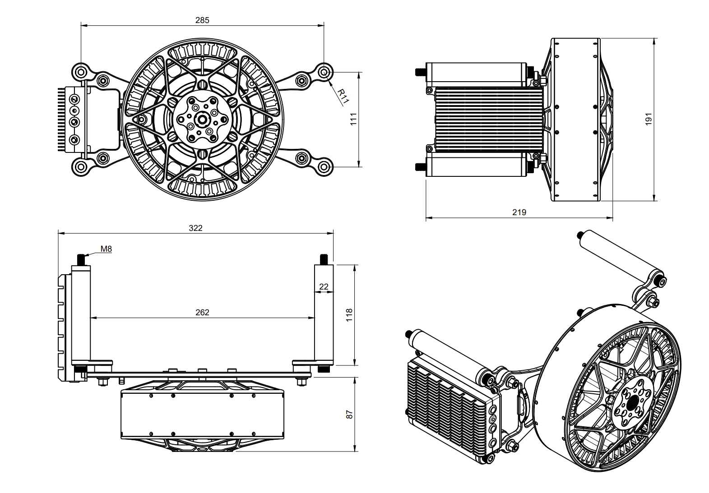
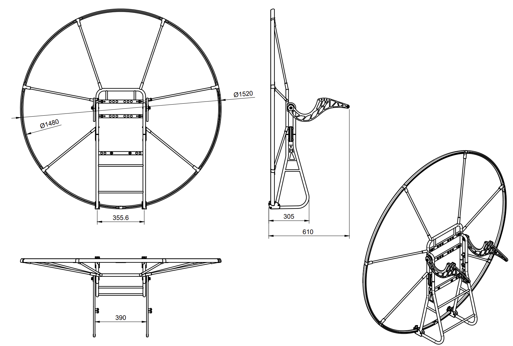

To look up any part on a 3D model, download its STEP or STL file, or order a replacement, use the [SP140 3D Part Picker](https://openppg.com/3d-part-finder/).

Complete 3D files can also be downloaded from GitHub:
[https://github.com/openppg/sp140-hardware/tree/main](https://github.com/openppg/sp140-hardware/tree/main)

## Size when assembled as ready to fly

**610x1520x1520mm**

## Shipping / Transport size:

**580x400x420mm**
